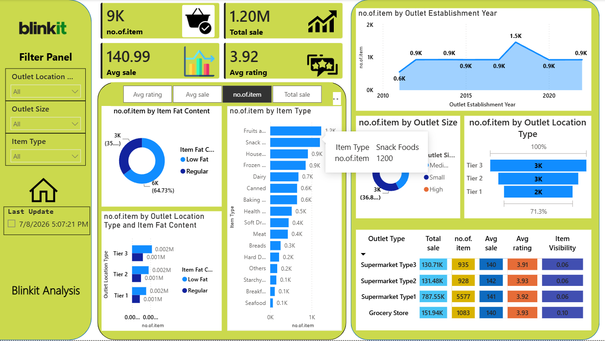

# Blinkit Sales Analysis Dashboard

## Project Overview
This project focuses on analyzing Blinkit sales data and creating an interactive dashboard using Microsoft Power BI.

The objective is to understand sales performance, product distribution, and business trends through data analysis and visualization.

## Tools & Technologies
- Microsoft Power BI
- Microsoft Excel
- Power Query
- DAX

## Data Analysis Process
1. Imported the dataset.
2. Cleaned and transformed data using Power Query.
3. Created measures using DAX.
4. Analyzed sales and product-related information.
5. Developed an interactive Power BI dashboard.

## Key Performance Indicators
- Total Sales
- Average Sales
- Number of Items
- Average Rating

## Dashboard Preview

## Project Files
- Blinkit_image.png
- blinkit dashboad.pbix

## Skills Demonstrated
- Data Cleaning
- Data Transformation
- Data Analysis
- Data Visualization
- Dashboard Development

